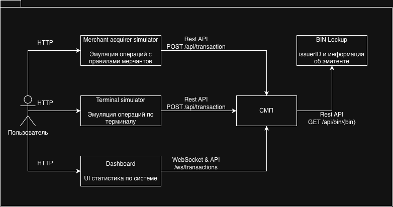

# А1. C4 Context — контекст СМП

## Чего не хватало и что сделано

- **Не хватало:** явно проведённой границы «СМП / внешний мир», перечня акторов и подписанных протоколов их взаимодействия.
- **Сделано:** СМП показана единым контуром; отдельно показаны терминал, мерчант, пользователь Dashboard и BIN Lookup. Подписаны REST-входы, каналы Dashboard и HTTP lookup BIN.

## Как читать диаграмму

СМП показана как одна система. POS-терминал и мерчант отправляют транзакции через Gateway по HTTP REST и получают синхронный ответ авторизации. Пользователь открывает Dashboard: браузер загружает интерфейс по HTTP(S), а сам интерфейс читает REST-данные и подключается к WebSocket журнала.

BIN Lookup показан за границей домена обработки платежа: это отдельная зависимость, вызываемая по HTTP `GET /api/bin/{bin}` для разрешения BIN в `issuerId`. В Docker Compose сервис физически поднимается вместе с приложением, но остаётся отдельным сервисом/контрактом. Не следует смешивать этот вызов с маршрутизацией Switch: Switch использует собственную локальную таблицу BIN → issuerId.

## Сверка с кодом

- [Условие практики 3](../../../../Lectures/materials/module-03-pyramid/practice/practice-03.md) и [инструктаж по диаграммам](../../../../Lectures/materials/module-03-pyramid/practice/practice-03-guide.md) задают акторов и требование явно подписать протоколы.
- [docker-compose.yaml](../../../docker-compose.yaml#L43) объявляет Gateway и внешние по отношению к нему сервисы; [BIN Lookup](../../../docker-compose.yaml#L179) также разворачивается отдельным контейнером.
- [Gateway routes](../../../services/gateway/src/main/resources/application.yml#L64) задают REST-маршрут `/api/transactions`, Dashboard API и маршруты к симуляторам.
- [Terminal Simulator GatewayClient](../../../services/terminal-simulator/src/main/java/com/processing/terminalsimulator/client/GatewayClient.java#L15) отправляет запрос на `/api/transactions` и получает `AuthorizationResponse`.
- [Merchant + Acquirer GatewayClient](../../../services/merchant-acquirer/src/main/java/com/processing/merchantacquirer/client/GatewayClient.java#L87) вызывает Gateway по REST.
- [BIN Lookup client](../../../services/authorization/src/main/java/com/processing/authorization/client/BinLookupClient.java#L45) извлекает первые 6 цифр PAN, вызывает внешний endpoint и возвращает пустой результат при ошибке; endpoint реализован в [BinLookupController](../../../services/bin-lookup/src/main/java/com/processing/binlookup/controller/BinLookupController.java#L18).
- [Dashboard WebSocket hook](../../../services/dashboard/src/hooks/useWebSocket.ts#L17) подключается к `/ws/transactions`; сервер регистрирует endpoint в [WebSocketConfig](../../../services/transaction-logger/src/main/java/com/processing/transactionlogger/websocket/WebSocketConfig.java#L25).

| Код | Что делает и какую связь подтверждает |
|---|---|
| [Terminal `GatewayClient.sendToGateway`](../../../services/terminal-simulator/src/main/java/com/processing/terminalsimulator/client/GatewayClient.java#L29) | Делает HTTP POST `/api/transactions` и читает `AuthorizationResponse`. |
| [Merchant `GatewayClient.processAuthorize`](../../../services/merchant-acquirer/src/main/java/com/processing/merchantacquirer/client/GatewayClient.java#L87) | Отправляет запрос авторизации в Gateway по REST. |
| [Gateway routes](../../../services/gateway/src/main/resources/application.yml#L64) | Маршрутизирует транзакции, запросы Dashboard и симуляторов к downstream-сервисам. |
| [Authorization `BinLookupClient.getIssuerId`](../../../services/authorization/src/main/java/com/processing/authorization/client/BinLookupClient.java#L51) | Извлекает первые 6 цифр PAN, вызывает `/api/bin/{bin}` и при ошибке возвращает `Optional.empty()`. |
| [Switch `RoutingService.getIssuerIdByPan`](../../../services/switch/src/main/java/com/processing/service/RoutingService.java#L30) | Находит issuerId по локальной карте BIN → issuerId; сетевого обращения к BIN Lookup здесь нет. |
| [Dashboard `useWebSocket`](../../../services/dashboard/src/hooks/useWebSocket.ts#L17) и [серверная регистрация](../../../services/transaction-logger/src/main/java/com/processing/transactionlogger/websocket/WebSocketConfig.java#L25) | UI открывает WebSocket `/ws/transactions`, сервер регистрирует endpoint. |