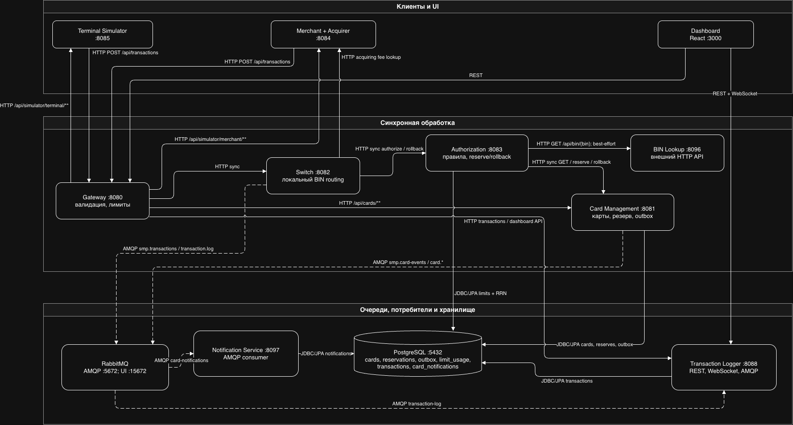

# А2. C4 Container — сервисы и способы связи

**Требование практики:** показать 11 сервисов, PostgreSQL, RabbitMQ и отличать sync HTTP/JDBC от async AMQP. В исходной архитектурной схеме эти виды стрелок не различались и не все async-пути были отражены. Здесь sync-связи показаны сплошными стрелками, AMQP — пунктиром; компоновка разделена на группы клиентов, обработки и хранилищ.

## Чего не хватало и что сделано

- **Не хватало:** сверки контейнеров и портов с Compose, разметки синхронных/асинхронных связей и отображения обоих async-путей.
- **Сделано:** показаны 11 именованных сервисов, PostgreSQL и RabbitMQ; связи подписаны транспортом и направлением, AMQP-публикации проведены пунктиром. Switch → Logger и Card Management outbox → Notification раскрыты отдельно в [описании RabbitMQ](05-rabbitmq-topology.md).

## Контейнеры

Диаграмма содержит Gateway, Switch, Authorization, Card Management, BIN Lookup, Transaction Logger, Notification Service, Terminal Simulator, Merchant + Acquirer, Dashboard и Autoscaler (опциональный профиль observability), а также PostgreSQL и RabbitMQ. Prometheus, Grafana и Loki — дополнительная observability-инфраструктура Compose, не часть этих 11 именованных сервисов.

## Порты из `docker-compose.yaml`

| Сервис | Порт с хоста | Compose `ports` | Назначение |
|---|---|---|---|
| Gateway | `8080` | `${GATEWAY_PORT}:8080` | Вход REST API |
| Card Management | `8081` | `${CARD_MGMT_PORT}:8080` | REST карт и резервов |
| Switch | `8082` | `${SWITCH_PORT}:8080` | REST Switch |
| Authorization | `8083` | `${AUTH_PORT}:8080` | REST authorize/rollback |
| Merchant + Acquirer | `8084` | `${MERCHANT_PORT}:8080` | API симулятора мерчанта/эквайера |
| Terminal Simulator | `8085` | `${TERMINAL_PORT:-8085}:8080` | API симулятора терминала |
| Transaction Logger | `8088` | `${LOGGER_PORT}:8080` | REST, Dashboard API, WebSocket |
| BIN Lookup | `8096` | `${BIN_LOOKUP_PORT:-8096}:8080` | HTTP lookup по BIN |
| Notification Service | `8097` | `${NOTIFICATION_PORT:-8097}:8080` | API/health сервиса уведомлений |
| Dashboard | `3000` | `${DASHBOARD_PORT}:3000` | Web UI |
| PostgreSQL | `5432` | `${DB_PORT}:5432` | Подключения к БД |
| RabbitMQ | `5672` / `15672` | `${RABBITMQ_AMQP_PORT:-5672}:5672`; `${RABBITMQ_MGMT_PORT:-15672}:15672` | AMQP / Management UI |
| Autoscaler | — | `ports` не объявлен | Не принимает пользовательский сетевой трафик |

## Механика связей

1. Terminal Simulator и Merchant + Acquirer отправляют HTTP-запросы в Gateway; Gateway направляет транзакцию в Switch. Gateway также проксирует API чтения транзакций/Dashboard, управление картами и API запуска симуляторов к соответствующим сервисам.
2. Switch синхронно вызывает Authorization и отдельно получает комиссию эквайринга у Merchant + Acquirer. Switch сам разрешает BIN через локальную конфигурацию, а не через сетевой вызов BIN Lookup.
3. Authorization вызывает Card Management по HTTP: получить карту, зарезервировать средства или выполнить rollback. Дополнительно Authorization вызывает BIN Lookup по HTTP как best-effort enrichment; при ошибке клиент возвращает пустой результат.
4. Authorization, Card Management, Transaction Logger и Notification Service подключаются к PostgreSQL через JDBC/JPA и работают со своими наборами таблиц.
5. Switch публикует запись транзакции через RabbitMQ для Logger. Card Management публикует карточные события через outbox для Notification Service. Публикация и обработка сообщения асинхронны, поэтому запись журнала/уведомления может появиться после HTTP-ответа клиенту.
6. Dashboard использует REST для данных и WebSocket для live-событий журнала.

## Сверка с кодом

- [Условие практики](../../../../Lectures/materials/module-03-pyramid/practice/practice-03.md) требует Container-диаграмму, различение sync/async и 11 сервисов; [docker-compose.yaml](../../../docker-compose.yaml#L3) — источник списка контейнеров, портов, environment URLs и зависимостей.
- [Gateway route config](../../../services/gateway/src/main/resources/application.yml#L64) связывает `/api/transactions` со Switch и показывает REST-маршруты других сервисов.
- [RouteService](../../../services/switch/src/main/java/com/processing/service/RouteService.java#L55) оркестрирует локальную маршрутизацию, Authorization и публикацию результата; [RoutingService](../../../services/switch/src/main/java/com/processing/service/RoutingService.java#L12) использует локальную таблицу BIN.
- [AuthServiceImpl](../../../services/authorization/src/main/java/com/processing/authorization/services/AuthServiceImpl.java#L43) показывает вызовы Card Management и BIN Lookup; HTTP-обёртки находятся в [CardManagementClientImpl](../../../services/authorization/src/main/java/com/processing/authorization/client/CardManagementClientImpl.java) и [BinLookupClient](../../../services/authorization/src/main/java/com/processing/authorization/client/BinLookupClient.java#L35).
- AMQP-путь транзакции реализован в [LoggerClient](../../../services/switch/src/main/java/com/processing/service/LoggerClient.java#L32), а путь карточных событий — в [OutboxEventProcessorImpl](../../../services/card-management/src/main/java/com/processing/cardmanagement/services/OutboxEventProcessorImpl.java#L31).
- PostgreSQL/RabbitMQ и сервисные подключения заданы в [docker-compose.yaml](../../../docker-compose.yaml#L4).

| Класс / метод или конфигурация | Что делает и какую связь подтверждает |
|---|---|
| [Gateway routes](../../../services/gateway/src/main/resources/application.yml#L64) | Проксирует POST `/api/transactions` в Switch и объявляет маршруты к Logger, симуляторам и Card Management. |
| [Switch `RouteService.route`](../../../services/switch/src/main/java/com/processing/service/RouteService.java#L55) | Оркестрирует sync BIN routing → Authorization → публикацию транзакции; при ошибке публикации после APPROVED запускает rollback. |
| [Switch `RoutingService.getIssuerIdByPan`](../../../services/switch/src/main/java/com/processing/service/RoutingService.java#L30) | Получает issuerId из локальной BIN-таблицы — сетевого вызова BIN Lookup из Switch нет. |
| [Authorization `AuthServiceImpl.authorize`](../../../services/authorization/src/main/java/com/processing/authorization/services/AuthServiceImpl.java#L43) | Проверяет карту/лимиты, вызывает best-effort BIN Lookup и Card Management. |
| [Authorization `CardManagementClientImpl`](../../../services/authorization/src/main/java/com/processing/authorization/client/CardManagementClientImpl.java#L40) | Выполняет синхронные HTTP GET карты и POST reserve/rollback в CMS. |
| [Switch `MerchantAcquirerClient.fetchAcquiringFee`](../../../services/switch/src/main/java/com/processing/service/MerchantAcquirerClient.java#L38) и [Merchant `SimulationController.getAcquirerFee`](../../../services/merchant-acquirer/src/main/java/com/processing/merchantacquirer/controller/SimulationController.java#L121) | Switch синхронно запрашивает комиссию через merchant simulator endpoint `/api/simulator/merchant/fee`. |
| [Switch `LoggerClient.log`](../../../services/switch/src/main/java/com/processing/service/LoggerClient.java#L38) и [Logger `handleTransaction`](../../../services/transaction-logger/src/main/java/com/processing/transactionlogger/listener/TransactionLogListener.java#L27) | Producer отправляет AMQP-сообщение; listener принимает его из `transaction-log`. |
| [CMS `CardEventNotifierImpl.notifyListeners`](../../../services/card-management/src/main/java/com/processing/cardmanagement/events/CardEventNotifierImpl.java#L15) | Сохраняет события типа `CardOutboxEvent` в outbox, вместо немедленной публикации из REST-операции. |
| [CMS `OutboxProcessor.process`](../../../services/card-management/src/main/java/com/processing/cardmanagement/services/OutboxProcessor.java#L21), [processor](../../../services/card-management/src/main/java/com/processing/cardmanagement/services/OutboxEventProcessorImpl.java#L31), [Notification `handleCardEvent`](../../../services/notification-service/src/main/java/com/processing/notification/listener/CardEventListener.java#L36) | Планировщик выбирает pending-события, processor публикует AMQP, consumer сохраняет уведомление. |
| [LimitUsageRepository.upsertLimitUsage](../../../services/authorization/src/main/java/com/processing/authorization/repositories/LimitUsageRepository.java#L61), [CardRepositoryPersistenceAdapter.update](../../../services/card-management/src/main/java/com/processing/cardmanagement/repositories/CardRepositoryPersistenceAdapter.java#L113), [TransactionService.store](../../../services/transaction-logger/src/main/java/com/processing/transactionlogger/service/TransactionService.java#L71) | Подтверждают JDBC/JPA-запись лимитов, карт и транзакций в PostgreSQL. |