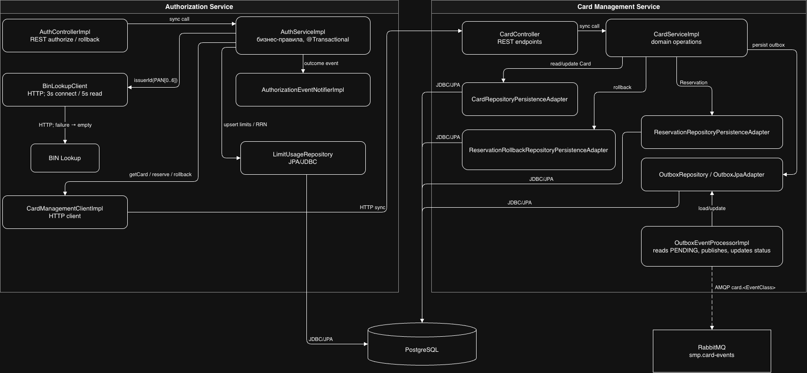

# А3. C4 Component — Authorization и Card Management

**Требование практики:** показать внутренние компоненты двух сервисов: controller → service → HTTP-клиенты/repositories, JDBC и outbox. Готовой компонентной схемы не было; она собрана по пакетам исходного кода.

## Чего не хватало и что сделано

- **Не хватало:** component-схем двух сервисов с границами HTTP-клиентов, бизнес-логики, репозиториев и outbox.
- **Сделано:** показаны Controller → Service → HTTP clients/JDBC в Authorization и Controller → Service → persistence adapters плюс отдельный outbox processor → RabbitMQ в Card Management.

## Authorization

`AuthControllerImpl` принимает запрос authorize/rollback и делегирует `AuthServiceImpl`. Сервис сначала получает карту через `CardManagementClientImpl`, затем best-effort обогащает запрос через `BinLookupClient`, проверяет статус карты, дату окончания, доступный баланс и дневной/месячный лимит. Лимитный счётчик и блоки генерации RRN обслуживаются `LimitUsageRepository`. При прохождении проверок сервис запрашивает reserve в Card Management и формирует APPROVED; ветви отказов выражены через `DeclineOutcome`.

## Card Management

`CardController` передаёт REST-запросы в `CardServiceImpl`. Сервис использует persistence adapters для карт, резервов и rollback; outbox-репозиторий хранит события. Отдельный `OutboxEventProcessorImpl` выбирает ожидающее событие, публикует его в RabbitMQ и сохраняет итог обработки. Так схема показывает шов между синхронной бизнес-операцией/БД и отдельной асинхронной публикацией.

Reserve уменьшает `availableBalance`, сохраняет Reservation со статусом `RESERVED` и генерирует событие. Rollback ищет резерв по RRN и PAN, создаёт запись возврата, меняет Reservation на `ROLLED_BACK` и восстанавливает доступный баланс. Обе операции исполняются внутри `TransactionRunner`.

## Сверка с кодом

- [Условие практики](../../../../Lectures/materials/module-03-pyramid/practice/practice-03.md) и [инструктаж](../../../../Lectures/materials/module-03-pyramid/practice/practice-03-guide.md) перечисляют обязательные внутренние связи.
- Authorization: [AuthControllerImpl](../../../services/authorization/src/main/java/com/processing/authorization/controller/AuthControllerImpl.java), [AuthServiceImpl](../../../services/authorization/src/main/java/com/processing/authorization/services/AuthServiceImpl.java#L43), [CardManagementClientImpl](../../../services/authorization/src/main/java/com/processing/authorization/client/CardManagementClientImpl.java), [BinLookupClient](../../../services/authorization/src/main/java/com/processing/authorization/client/BinLookupClient.java#L51), [LimitUsageRepository](../../../services/authorization/src/main/java/com/processing/authorization/repositories/LimitUsageRepository.java), [DeclineOutcome](../../../services/authorization/src/main/java/com/processing/authorization/constants/DeclineOutcome.java#L69).
- Card Management: [CardController](../../../services/card-management/src/main/java/com/processing/cardmanagement/controllers/CardController.java#L73), [CardServiceImpl.reserve/rollback](../../../services/card-management/src/main/java/com/processing/cardmanagement/services/CardServiceImpl.java#L197), [CardRepositoryPersistenceAdapter](../../../services/card-management/src/main/java/com/processing/cardmanagement/repositories/CardRepositoryPersistenceAdapter.java), [ReservationRepositoryPersistenceAdapter](../../../services/card-management/src/main/java/com/processing/cardmanagement/repositories/ReservationRepositoryPersistenceAdapter.java), [OutboxRepository](../../../services/card-management/src/main/java/com/processing/cardmanagement/repositories/OutboxRepository.java), [OutboxEventProcessorImpl](../../../services/card-management/src/main/java/com/processing/cardmanagement/services/OutboxEventProcessorImpl.java#L31).
- Доменные механики: [Card](../../../services/card-management/src/main/java/com/processing/cardmanagement/models/Card.java#L101), [Reservation](../../../services/card-management/src/main/java/com/processing/cardmanagement/models/Reservation.java#L49), [TransactionRunnerImpl](../../../services/card-management/src/main/java/com/processing/cardmanagement/services/TransactionRunnerImpl.java).

| Класс / метод | Что делает и какую стрелку подтверждает |
|---|---|
| [AuthControllerImpl.authorize](../../../services/authorization/src/main/java/com/processing/authorization/controller/AuthControllerImpl.java#L66) / [rollback](../../../services/authorization/src/main/java/com/processing/authorization/controller/AuthControllerImpl.java#L118) | Принимают REST-запросы и вызывают соответствующие методы Authorization service. |
| [AuthServiceImpl.authorize](../../../services/authorization/src/main/java/com/processing/authorization/services/AuthServiceImpl.java#L43) | Загружает карту, проверяет статус, срок, средства и лимиты; при успехе вызывает reserve, при отказе строит `DeclineOutcome`. |
| [CardManagementClientImpl.getCard](../../../services/authorization/src/main/java/com/processing/authorization/client/CardManagementClientImpl.java#L40), [reserve](../../../services/authorization/src/main/java/com/processing/authorization/client/CardManagementClientImpl.java#L65), [rollback](../../../services/authorization/src/main/java/com/processing/authorization/client/CardManagementClientImpl.java#L101) | Переводят чтение карты, резервирование и возврат в синхронные HTTP-запросы к CMS. |
| [BinLookupClient.getIssuerId](../../../services/authorization/src/main/java/com/processing/authorization/client/BinLookupClient.java#L51) | Вызывает BIN Lookup по HTTP и при ошибке возвращает empty result. |
| [CardController.getCard](../../../services/card-management/src/main/java/com/processing/cardmanagement/controllers/CardController.java#L73), [reserve](../../../services/card-management/src/main/java/com/processing/cardmanagement/controllers/CardController.java#L218), [rollback](../../../services/card-management/src/main/java/com/processing/cardmanagement/controllers/CardController.java#L242) | REST-адаптер для чтения карты, резервирования и компенсации. |
| [CardServiceImpl.reserve](../../../services/card-management/src/main/java/com/processing/cardmanagement/services/CardServiceImpl.java#L197) | Проверяет карту и RRN, сохраняет резерв, уменьшает доступный баланс и отправляет доменное событие notifier-у. |
| [CardServiceImpl.rollback](../../../services/card-management/src/main/java/com/processing/cardmanagement/services/CardServiceImpl.java#L212) | Находит резерв по RRN/PAN, помечает его возвращённым и восстанавливает баланс. |
| [CardEventNotifierImpl.notifyListeners](../../../services/card-management/src/main/java/com/processing/cardmanagement/events/CardEventNotifierImpl.java#L15) | Для событий `CardOutboxEvent` создаёт `CardOutboxEventData` и сохраняет запись через OutboxEventProcessor; прочие события идут обычным listeners. |
| [OutboxProcessor.process](../../../services/card-management/src/main/java/com/processing/cardmanagement/services/OutboxProcessor.java#L21) и [OutboxEventProcessorImpl.processSingleEvent](../../../services/card-management/src/main/java/com/processing/cardmanagement/services/OutboxEventProcessorImpl.java#L31) | Планировщик выбирает pending-события; processor публикует их в RabbitMQ и сохраняет статус обработки. |
| [CardRepositoryPersistenceAdapter.update](../../../services/card-management/src/main/java/com/processing/cardmanagement/repositories/CardRepositoryPersistenceAdapter.java#L113), [LimitUsageRepository.upsertLimitUsage](../../../services/authorization/src/main/java/com/processing/authorization/repositories/LimitUsageRepository.java#L61) | Персистят карту через JPA и атомарно увеличивают дневной/месячный расход лимита в БД. |
