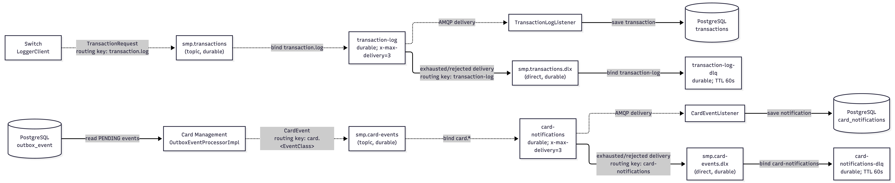

# А5. RabbitMQ — exchanges, queues и DLQ

**Требование практики:** визуализировать exchange → queue → consumer, DLX/DLQ, publisher confirms (2s), retry и TTL. В документации была таблица, но отдельной топологической диаграммы не было; здесь показаны оба независимых маршрута сообщений и отдельные механизмы повторов.

## Чего не хватало и что сделано

- **Не хватало:** графического пути сообщений от producer через exchange/binding/queue к consumer и месту записи, включая dead-letter-маршруты.
- **Сделано:** показаны transaction-log и card-event потоки, bindings/routing keys, durable queues, consumers, DLX/DLQ и БД назначения. В тексте отделены consumer redelivery, outbox retry и publisher confirm.

## Поток журнала транзакций

Switch публикует в topic exchange `smp.transactions` с routing key `transaction.log`. Binding доставляет сообщение в durable queue `transaction-log`, которую слушает Transaction Logger. Listener записывает транзакцию в PostgreSQL. У очереди задан dead-letter exchange `smp.transactions.dlx` и ключ `transaction-log`; после dead-letter маршрутизации сообщение попадает в `transaction-log-dlq`, где настроен TTL 60 секунд.

## Поток карточных событий

Card Management сначала хранит карточное событие в outbox. `OutboxEventProcessorImpl` публикует его в `smp.card-events` с ключом `card.<EventClass>`. Binding `card.*` маршрутизирует его в `card-notifications`; Notification Service сохраняет уведомление в БД. DLX `smp.card-events.dlx` с ключом `card-notifications` ведёт в `card-notifications-dlq`, у которой TTL 60 секунд.

## Повторы и подтверждения — разные механики

- Consumer очередей: в конфигурации задан аргумент `x-max-delivery=3`, очередь направляет dead-letter сообщение в DLX. Реальная политика redelivery также зависит от listener container и семантики используемого брокера; не приравнивайте одну декларацию аргумента к проверенной политике трёх retry с backoff.
- Outbox producer: при исключении событие получает увеличенный `retryCount`; после `maxRetryCount` помечается `FAILED`. Это повторная обработка публикации события из БД, а не повторная доставка сообщения consumer-у.
- Switch publisher confirms: в конфигурации включён режим CORRELATED; учебное описание указывает timeout 2s и компенсационный rollback. Однако [LoggerClient](../../../services/switch/src/main/java/com/processing/service/LoggerClient.java#L38) не ожидает `CorrelationData` явно, поэтому confirm → rollback по таймауту не подтверждается только наличием настройки.

## Сверка с кодом

- [Условие практики](../../../../Lectures/materials/module-03-pyramid/practice/practice-03.md) и [инструктаж](../../../../Lectures/materials/module-03-pyramid/practice/practice-03-guide.md) содержат требование к визуализации и учебные параметры механики.
- Транзакционная топология объявлена в [Switch RabbitMQConfig](../../../services/switch/src/main/java/com/processing/config/RabbitMQConfig.java#L22) и повторно в [Logger RabbitMQConfig](../../../services/transaction-logger/src/main/java/com/processing/transactionlogger/config/RabbitMQConfig.java#L20); consumer — [TransactionLogListener](../../../services/transaction-logger/src/main/java/com/processing/transactionlogger/listener/TransactionLogListener.java#L27).
- Карточная топология объявлена в [Card Management RabbitMQConfig](../../../services/card-management/src/main/java/com/processing/cardmanagement/config/RabbitMQConfig.java#L26) и [Notification RabbitMQConfig](../../../services/notification-service/src/main/java/com/processing/notification/config/RabbitMQConfig.java#L21); consumer — [CardEventListener](../../../services/notification-service/src/main/java/com/processing/notification/listener/CardEventListener.java#L36).
- Публикация outbox-события и обработка ошибки: [OutboxEventProcessorImpl](../../../services/card-management/src/main/java/com/processing/cardmanagement/services/OutboxEventProcessorImpl.java#L31), retry state: [CardOutboxEventData](../../../services/card-management/src/main/java/com/processing/cardmanagement/models/CardOutboxEventData.java#L47), лимит повтора: [application.properties](../../../services/card-management/src/main/resources/application.properties#L67).
- Switch publish confirm setting: [switch application.yml](../../../services/switch/src/main/resources/application.yml#L5); fallback/compensation decision: [RouteService](../../../services/switch/src/main/java/com/processing/service/RouteService.java#L84).

| Класс / метод | Что делает и какую часть топологии подтверждает |
|---|---|
| [Switch RabbitMQConfig](../../../services/switch/src/main/java/com/processing/config/RabbitMQConfig.java#L30) и [Logger RabbitMQConfig](../../../services/transaction-logger/src/main/java/com/processing/transactionlogger/config/RabbitMQConfig.java#L28) | Объявляют topic exchange, durable `transaction-log`, binding `transaction.log`, DLX и DLQ с TTL. |
| [LoggerClient.log](../../../services/switch/src/main/java/com/processing/service/LoggerClient.java#L38) | Публикует TransactionRequest в exchange/routing key из конфигурации. |
| [TransactionLogListener.handleTransaction](../../../services/transaction-logger/src/main/java/com/processing/transactionlogger/listener/TransactionLogListener.java#L27) | Слушает `transaction-log` и делегирует сохранение транзакции. |
| [Card Management RabbitMQConfig](../../../services/card-management/src/main/java/com/processing/cardmanagement/config/RabbitMQConfig.java#L47) и [Notification RabbitMQConfig](../../../services/notification-service/src/main/java/com/processing/notification/config/RabbitMQConfig.java#L42) | Объявляют `smp.card-events`, binding `card.*`, `card-notifications`, DLX/DLQ. |
| [CardEventNotifierImpl.notifyListeners](../../../services/card-management/src/main/java/com/processing/cardmanagement/events/CardEventNotifierImpl.java#L15) | Сохраняет карточное outbox-событие в БД в рамках обработки доменного события. |
| [OutboxProcessor.process](../../../services/card-management/src/main/java/com/processing/cardmanagement/services/OutboxProcessor.java#L21) и [OutboxEventProcessorImpl.processSingleEvent](../../../services/card-management/src/main/java/com/processing/cardmanagement/services/OutboxEventProcessorImpl.java#L31) | По расписанию выбирают ожидающие события и публикуют с routing key `card.` + имя класса события; исключения увеличивают счётчик retry, затем событие становится FAILED. |
| [CardEventListener.handleCardEvent](../../../services/notification-service/src/main/java/com/processing/notification/listener/CardEventListener.java#L36) | Разбирает JSON/routing key и сохраняет уведомление через репозиторий. |
| [TransactionService.store](../../../services/transaction-logger/src/main/java/com/processing/transactionlogger/service/TransactionService.java#L71) | Сохраняет полученную из очереди транзакцию и рассылает WebSocket-событие после успешной записи. |
