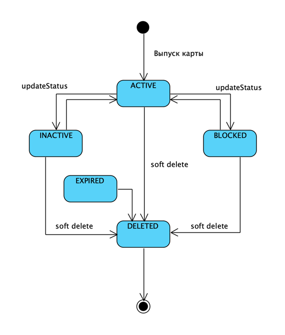
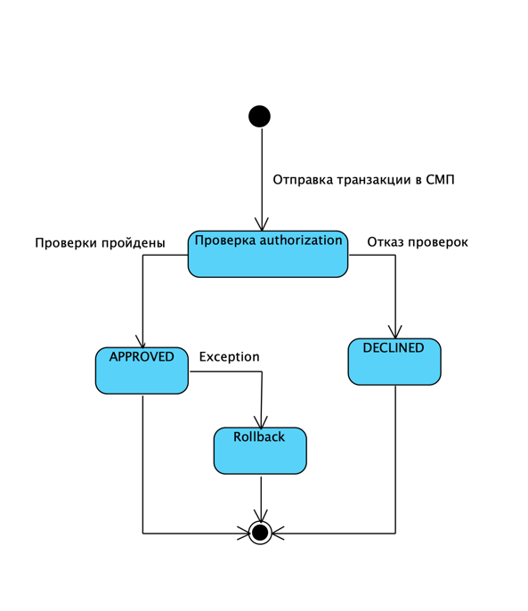

# А6. Статусы карты, резерва и прохождения транзакции

## Результат проверки достоверности

В прежней версии смешивались статусы данных и этапы выполнения: `AUTHORIZING` и `ROLLED_BACK` были показаны как состояния транзакции. Код это не подтверждает. В Logger enum и ограничение БД допускают только `APPROVED` и `DECLINED`. `ROLLED_BACK` — статус резерва карты; `AUTHORIZING` и компенсация — этапы выполнения `RouteService`, а не сохраняемые статусы транзакции.

Также уточнён путь сбоя: после ошибки публикации APPROVED-сообщения Switch пытается отменить резерв, но затем возвращает клиенту `DECLINED` с кодом `96` независимо от того, удался ли rollback. Поскольку публикация не была принята RabbitMQ, этой транзакции нет в Logger. Если исходный статус уже был `DECLINED`, ошибка публикации не запускает rollback: Switch возвращает первоначальный ответ отказа.

## Статусы результата транзакции — подтверждение кодом

### `APPROVED`

Статус присваивается успешному ответу Authorization. В Authorization до него выполняются проверки и создание резерва; ответ формируется только после успешного вызова `reserve`.

Фабрика ответа ставит статус `APPROVED` и код `00`

Switch копирует статус ответа в DTO, отправляемый Logger

Если RabbitMQ принимает публикацию, Logger получает именно этот статус. Это статус результата авторизации, а не промежуточный статус процесса.

### `DECLINED`

Отказ формируется для отрицательного результата проверки или недоступной зависимости. Например, код Authorization выбирает причину для статуса карты, отличного от `ACTIVE`, и возвращает отказ при просроченном `expiryDate`

Неуспешное резервирование также заканчивается `DECLINED`: например, недостаток средств или ошибка резерва обрабатываются в `catch`-ветках метода

### Какие статусы хранит Logger

Enum [`TransactionStatus`](../../../services/common/src/main/java/com/processing/common/dto/transactionlogger/TransactionStatus.java#L6) содержит только два значения:

База данных ограничивает поле теми же значениями ([миграция таблицы transactions](../../../services/transaction-logger/src/main/resources/db/migration/V1__create_transactions_table.sql#L23)):

`RouteService.buildTransaction` преобразует `response.status()` через `TransactionStatus.valueOf(status)` ([метод преобразования](../../../services/switch/src/main/java/com/processing/service/RouteService.java#L173)). Следовательно, `AUTHORIZING`, `PROCESSING`, `COMPENSATING` и `ROLLED_BACK` не являются статусами Logger.

## Ошибка публикации после APPROVED

В [`RouteService.route`](../../../services/switch/src/main/java/com/processing/service/RouteService.java#L84) сначала строится Logger DTO и выполняется публикация. Только если публикация не удалась и исходный ответ APPROVED, выполняется rollbac

`systemError` формирует API-ответ `DECLINED` / `96` ([код метода](../../../services/common/src/main/java/com/processing/common/dto/authorization/AuthorizationResponse.java#L64)). Метод [`AuthorizationClient.rollback`](../../../services/switch/src/main/java/com/processing/service/AuthorizationClient.java#L99) при ошибке возвращает `null`, а `RouteService` всё равно возвращает `systemError`. Значит, rollback — компенсирующая попытка, а не обязательный успешный переход статуса транзакции. Logger-строка в этом сценарии не сохранена: `LoggerClient.log` возвращает `false`, когда отправка в RabbitMQ завершилась `AmqpException` ([код](../../../services/switch/src/main/java/com/processing/service/LoggerClient.java#L38)).

## Вспомогательные статусы диаграммы

Это отдельные модели, не статусы транзакции.

### `ReservationStatus`: `RESERVED` → `ROLLED_BACK`

Enum резерва содержит два значения

Точный путь `RESERVED`: конструктор `Reservation` присваивает статус, а `CardServiceImpl.reserve` сохраняет сущность

`startRollback` запрещает повторную отмену

`CardServiceImpl.rollback` сохраняет возврат и обновлённый резерв, затем возвращает сумму в доступный баланс карты

### `CardStatus`: значения и смысл для авторизации

`CardStatus` содержит `ACTIVE`, `INACTIVE`, `BLOCKED`, `EXPIRED`, `DELETED`

В доменной модели reserve разрешён только для `ACTIVE`

В Authorization `INACTIVE`, `BLOCKED` и `EXPIRED` имеют отдельные причины отказа

`EXPIRED` присутствует в enum, но истечение `expiryDate` не переводит автоматически поле `Card.status` в `EXPIRED`: Authorization сравнивает дату и возвращает отказ для конкретной операции

Поэтому `DELETED` не следует считать необратимым terminal-state; диаграмма показывает примеры административных изменений, а не полный набор парных переходов.
