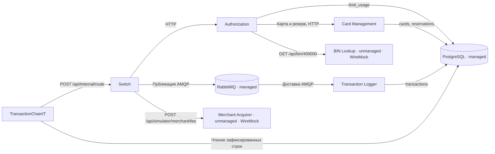

# Практика 6. Интеграционное тестирование СМП

## 1. Граница unit- и интеграционных тестов

Unit-тесты проверяют бизнес-решения сервиса на заданных ответах зависимостей. В `AuthServiceImplTest` Mockito задаёт результат `upsertLimitUsage`, а тест проверяет реакцию авторизации на принятие или отказ операции. `LimitUsageRepositoryIT` вызывает тот же метод на PostgreSQL и проверяет фактическое число затронутых строк и сохранённые суммы. Так проверяются нативный SQL и уникальный ключ `(pan, usage_date)`.

В `CardRepositoryIT` проверяется отображение доменной карты в SQL и обратно. Отдельный тест Transaction Logger проверяет реальную маршрутизацию сообщения в RabbitMQ и реакцию потребителя. Сквозной тест начинается с HTTP-вызова и проверяет результаты внутри трёх сервисов по данным в PostgreSQL.

## 2. Чек-лист персистентности

| Проверка | Где и что проверяется |
| --- | --- |
| Round-trip | `CardRepositoryIT` сохраняет карту и читает её по PAN в новой транзакции. Сверяются идентификатор, статус, срок действия, суммы и остальные поля. |
| Ограничения целостности | `CardRepositoryIT` проверяет `PanCollisionException` при совпадении PAN двух активных карт и создание новой карты с PAN удалённой. SQL-запрос дополнительно подтверждает состояние строк после операции. |
| Миграции на чистой БД | Контекст `CardRepositoryIT` запускает Flyway `V5.1–V5.8` на пустом PostgreSQL и валидирует схему Hibernate. У Transaction Logger также применяются штатные миграции. В Authorization Hibernate создаёт таблицу через `ddl-auto: update`, а Flyway управляет sequence `rrn_seq`. |
| Диалектные операции | `LimitUsageRepositoryIT` проверяет вставку, `ON CONFLICT DO UPDATE` и условие дневного лимита. Повторный вызов доводит две накопленные суммы ровно до дневного лимита в одной строке. |
| Транзакционность | После отклонённой вставки дубликата в БД остаётся только исходная карта. Запрещённый `upsertLimitUsage` обновляет ноль строк, обе накопленные суммы сохраняются. В сквозном тесте после HTTP-ответа отдельно читаются зафиксированные лимиты, резерв и баланс. |

`TransactionLoggerDlqIT` отправляет повреждённый JSON в `smp.transactions` с ключом `transaction.log`. Тест дожидается исходного сообщения в `transaction-log-dlq`, сверяет его байты и `x-death` с причиной `rejected`, проверяет пустую основную очередь и отсутствие записи в БД. Следующее сообщение содержит штатный `TransactionRequest`. Тест подтверждает его запись по UUID, RRN, STAN и сумме. TTL диагностической очереди в тестовой топологии такой же, как в Switch, 60 секунд.

## 3. Локальное сравнение с H2

Эксперимент выполнен на H2 `2.3.232` в режиме совместимости с PostgreSQL в отдельной временной копии. При запуске со штатным Flyway миграции `V5.1–V5.7` прошли, а `V5.8` завершилась с SQLSTATE `42000` на `WHERE` частичного индекса `uk_cards_pan`. Контекст не поднялся, поэтому проверки репозитория не выполнились.

Во втором варианте Flyway был отключён, а схему создал Hibernate (`ddl-auto=create-drop`). Очистка таблицы в этой копии выполнялась через `DELETE FROM cards`, чтобы сравнение касалось ограничений схемы.

| Сценарий | PostgreSQL со штатным Flyway | H2 со схемой Hibernate |
| --- | --- | --- |
| Сохранить карту и прочитать её по PAN | Прошёл | Прошёл |
| Отклонить дубликат активного PAN | Прошёл | Прошёл |
| Переиспользовать PAN удалённой карты | Прошёл | `PanCollisionException` |

Hibernate создал для H2 безусловный `UNIQUE` по аннотации сущности. Первые два зелёных теста на H2 дают ложную уверенность в эквивалентности схем. Третий выявляет различие между безусловной уникальностью и частичным индексом PostgreSQL, который учитывает статус карты.

## 4. Изоляция и воспроизводимость

- Каждый `*IT` запускает свои зависимости как статические `@Container`. Срезы JPA и Logger получают настройки подключения через `@ServiceConnection`. Сквозной сценарий поднимает отдельную Docker-сеть для своих контейнеров. Порты на хосте назначаются динамически, тесты не используют локальный стек из `docker-compose.yaml`.
- В `@BeforeEach` изменяемые таблицы очищаются через `TRUNCATE ... RESTART IDENTITY CASCADE`. Начальные данные миграций, например каталог BIN, остаются доступны. В брокере очищаются основная очередь Logger и DLQ. Сквозной сценарий также сбрасывает журнал запросов WireMock.
- Репозиторные тесты генерируют отдельный PAN для каждого метода. Асинхронный тест создаёт UUID, RRN, STAN и PAN для своего события. В сквозном сценарии Card Management генерирует PAN при создании карты, тест задаёт STAN, а RRN получает из ответа Switch.
- В JPA-срезах отключена общая тестовая транзакция. Изменения выполняются через `TransactionTemplate`, а результаты читаются в новой транзакции после коммита. Сквозной тест подготавливает карту отдельным HTTP-запросом и читает результаты новой JDBC-сессией после завершения запроса авторизации.
- Для асинхронных результатов используется Awaitility с интервалом опроса 100 мс и пределом 5 секунд. Таймауты готовности контейнеров задаются отдельно от ожидания обработки сообщения.

## 5. Сквозная цепочка и зависимости



Maven собирает штатные JAR четырёх сервисов. Testcontainers запускает их внутри Java 21 и ждёт readiness через Actuator. Оба внешних контракта обслуживает один контейнер WireMock. Тест проверяет вызов каждого контракта и сохранение полученной комиссии. Положительный ответ `APPROVED` связывается через PAN и RRN с лимитом Authorization, резервом и изменённым балансом Card Management, а также записью Logger, доставленной через RabbitMQ.

## Запуск

Из корня репозитория при работающем Docker, Maven и JDK 21:

```bash
mvn -B -ntp -f services/pom.xml -Pintegration-tests verify
```

Профиль собирает сервисы, запускает unit-тесты через Surefire, а интеграционные тесты через Failsafe. Failsafe складывает XML-результаты в `services/<service>/target/failsafe-reports/`. Job `integration-tests` в GitHub Actions выполняет два последовательных прогона на одном runner и сохраняет результаты обоих прогонов отдельными артефактами.

## Результаты локальной проверки

26 ноября 2026 года полный набор последовательно запущен дважды на одном Docker-хосте с JDK 21.0.10 и Docker Engine 29.3.1.

| Прогон | Интеграционные | Unit | Падения, ошибки и пропуски | Итог |
| --- | ---: | ---: | ---: | --- |
| Первый | 8 | 82 | 0 | `BUILD SUCCESS`, 1 мин 18 с |
| Повторный | 8 | 82 | 0 | `BUILD SUCCESS`, 1 мин 12 с |

Повторный запуск использовал тот же Docker-хост и сохранил отдельные XML-результаты в `failsafe-reports-repeat`. На момент подготовки отчёта подтверждены локальные прогоны.
